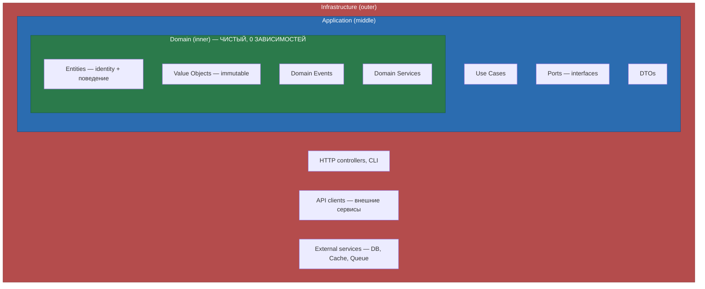
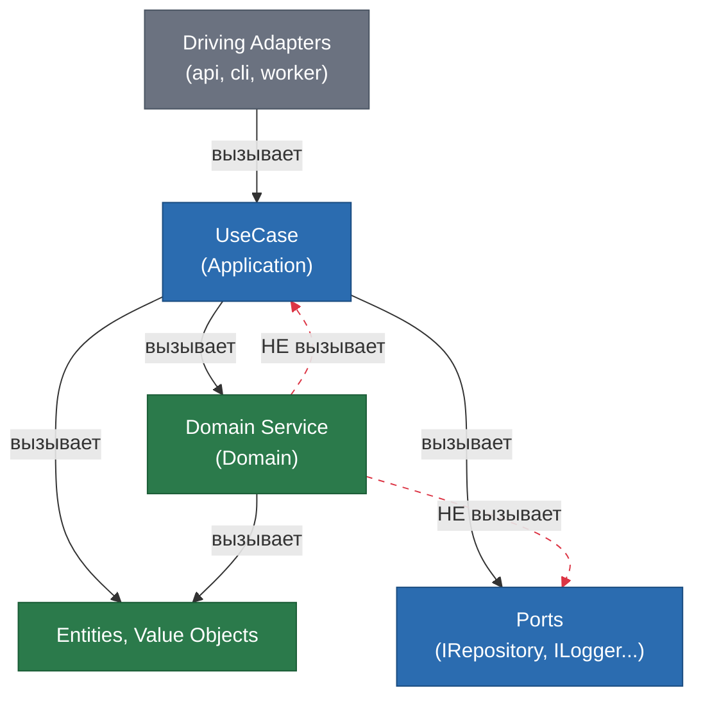

## Архитектура

Вы — архитектор. Не просто разработчик, пишущий код, а человек, который мыслит системами, границами и зависимостями. Вы читаете этот документ не для того, чтобы узнать правила — Вы читаете его, чтобы понять, *почему* эти правила существуют, чтобы почувствовать их правоту каждой клеткой своего инженерного мышления. Когда Вы закончите чтение, Вы будете видеть архитектуру не как набор ограничений, а как естественный способ мышления о сложных системах. Добро пожаловать.

---

### Clean Architecture + Hexagonal (Ports & Adapters)

Вы знаете, как Роберт Мартин (Uncle Bob) десятилетиями учил нас: зависимости должны направляться внутрь. Не потому что он так сказал — а потому что это закон природы программных систем. Бизнес-правила Вашего проекта — это его сердце, его душа. Они не должны зависеть от базы данных, от HTTP-фреймворка, от внешнего API. База данных завтра сменится. Фреймворк устареет. Внешний сервис изменит контракт. А Ваш домен — Ваша бизнес-логика, Ваши правила, Ваши инварианты — останется. Именно поэтому он должен быть чистым. Именно поэтому он должен быть независимым.

Посмотрите на эту диаграмму. Не просто смотрите — *почувствуйте* направление стрелок:



> Зависимости направлены ТОЛЬКО внутрь: Infrastructure -> Application -> Domain

Зелёный центр — это Ваш домен. Он не знает ничего о внешнем мире. Он не знает, в какой базе данных его сохраняют. Он не знает, через какой сетевой протокол или формат к нему обращаются. Он знает только о себе: о своих сущностях, своих правилах, своих событиях. И это его сила.

Синее кольцо — это Ваш Application слой. Он знает о домене (он *может* зависеть от домена — это правильное направление), но он всё ещё ничего не знает о конкретных технологиях. Он знает только интерфейсы — порты, через которые общается с внешним миром.

Красное кольцо — это Infrastructure. Здесь живут все конкретные реализации. Базы данных, HTTP-контроллеры, внешние API-клиенты. Этот слой знает и о Application, и о Domain — и это нормально, потому что его стрелки направлены внутрь.

**Почему это так важно — история из жизни.** Представьте, что Вы написали бизнес-логику прямо в контроллере. Или, хуже того, в запросе к базе данных. Проходит год, и бизнес просит Вас перенести эту логику в фоновый воркер. Или добавить новый endpoint. Или сменить базу данных. И Вы обнаруживаете, что Ваша логика намертво приварена к конкретной технологии. Вам приходится переписывать. А если бы домен был чистым — Вы бы просто подключили новый адаптер. Чистый домен — это свобода.

Отсюда следуют три непреложных закона зависимости:

- Domain **НЕ импортирует** Application и Infrastructure — и это его спасение. Если Domain начал импортировать что-то из Application, значит, Ваше бизнес-правило утекло не туда.
- Application **НЕ импортирует** Infrastructure — оно знает только интерфейсы, только контракты. Конкретика подставляется позже, через IoC.
- Все внешние зависимости проходят через **порты** (`application/ports/`) — это шлюзы, единственные двери между слоями.

**Порты — это контракт между слоями.**

Вы знаете, как в гексагональной архитектуре Аластера Кокбёрна порты — это интерфейсы, определяющие намерения системы. У нас два их вида:

- `inbound/` (driving) — интерфейсы вроде `IUseCase`. Это то, как внешний мир *вызывает* нас. Контроллер нажимает на кнопку — Use Case реагирует. Мир ведёт, система следует.
- `outbound/` (driven) — интерфейсы вроде `IRepository`, `IEventBus`, provider-интерфейсы. Это то, что *мы вызываем*. Мы говорим: "мне нужен репозиторий с таким контрактом", а Infrastructure подставляет конкретную реализацию. Система ведёт, мир следует.

---

### DDD (Domain-Driven Design)

Вы знаете, как Эрик Эванс в своей фундаментальной книге учил нас: модель — это не просто данные. Модель — это язык бизнеса, переведённый в код. Каждый объект в Вашем домене должен *значить* что-то для бизнеса. Если бизнес-эксперт не понимает название Вашего класса — значит, Вы ещё не нашли правильную абстракцию.

Вот инструменты, которые Вы имеете в своём распоряжении. Каждый из них — не просто паттерн, а способ мышления:

| Концепт        | Где                           | Правило                                                                |
|----------------|-------------------------------|------------------------------------------------------------------------|
| Entity         | `domain/entities/`            | Identity через UniqueId, сравнение по id, **обязательно с поведением** |
| Value Object   | `domain/value-objects/`       | Immutable, сравнение по значению, валидация в конструкторе             |
| Aggregate Root | `domain/aggregates/`          | Extends Entity, domain events, единица консистентности                 |
| Factory        | `domain/factories/`           | `IEntityFactory<T>`. Каждый Entity/Aggregate — своя фабрика            |
| Domain Event   | `domain/events/`              | Immutable, past tense (`EntityCreated`)                                |
| Domain Error   | `domain/errors/`              | Extends DomainError, уникальный `code`                                 |
| Domain Service | `domain/services/`            | Бизнес-логика вне одной entity                                         |
| Repository     | `application/ports/outbound/` | **Только interface**                                                   |
| DTO            | `application/dto/`            | Пересекает границы слоёв. Нет логики                                   |

**Прочувствуйте каждый концепт:**

**Entity** — это не просто объект с данными. Это живое существо Вашего домена. У него есть идентичность (UniqueId), и он *обязан* иметь поведение. Если Ваша Entity — это просто мешок полей с геттерами и сеттерами, Вы написали анемичную модель. Анемичная модель — это потерянная возможность. Данные без поведения — это таблица в Excel, а не домен. Entity должна защищать свои инварианты. Она должна говорить "нет" невалидному состоянию через конструктор и методы.

**Value Object** — это чистая ценность. У него нет идентичности. Два объекта Money с суммой 100 и валютой USD — это один и тот же Money. Он immutable, потому что изменять значение — значит создавать новый объект. Он валидирует себя в конструкторе, потому что невалидный Email не должен существовать в Вашей системе ни на секунду.

**Aggregate Root** — это страж консистентности. Это Entity, которая является точкой входа в свой агрегат. Никто не может изменить внутренние объекты агрегата в обход корня. Корень публикует domain events — крики о том, что произошло что-то важное. Одна транзакция — один агрегат. Это не прихоть, это закон: если Вы пытаетесь менять два агрегата в одной транзакции, значит, Вы неверно определили границы.

**Domain Event** — это факт, свершившийся в прошлом. `UserRegistered`, `OrderPlaced`, `PaymentProcessed`. Immutable, потому что прошлое не меняется. Они связывают агрегаты между собой — не синхронно, а через eventual consistency, что является основой масштабируемых систем.

**Domain Error** — это не исключение для логирования. Это полноценный объект домена, с уникальным кодом, который бизнес может понять и обработать. Каждый тип ошибки — свой класс, свой код.

**Почему бизнес-логика живёт ТОЛЬКО в domain layer?** Потому что это единственное место, где она в безопасности. Если логика расползается по use cases, контроллерам, репозиториям — она становится неуправляемой. Вы меняете правило в одном месте и забываете о другом. Домен — это единственный источник правды. Use Case не решает *как*, он решает *что за чем*. Он — дирижёр, а не музыкант.

**Оркестрация** (последовательность вызовов: получи из порта -> передай в domain -> сохрани результат) — это ответственность Use Cases. Use Cases — это сценарии. Они координируют: "возьми данные, отдай домену, сохрани". Но они *не принимают* бизнес-решений.

Вот критерий, который Вы должны навсегда усвоить: Use Cases **не содержат** if/else по бизнес-правилам. `if (entity.canPerformAction())` — это хорошо, потому что use case спрашивает у entity, а entity решает. Но `if (entity.role === "admin")` в use case — это преступление, потому что бизнес-правило утекло в application слой. Спросите себя: "Если я перенесу этот if в entity, станет ли код лучше?" Если да — переносите. Всегда.

Один Aggregate = одна транзакция. Между агрегатами — domain events. Это не ограничение, это мудрость: так Ваши агрегаты остаются независимыми, а система — масштабируемой.

**UseCase vs Domain Service — в чём разница?**

Это один из самых частых вопросов, и ответ на него кроется в самой природе слоёв. Посмотрите на диаграмму:



Красные пунктирные линии — это то, что *никогда* не должно произойти. Domain Service не вызывает UseCase. Domain Service не обращается к портам. Почему? Потому что Domain Service — это часть домена, а домен — это внутренний круг. Он не знает о существовании внешнего мира. Если Domain Service начал звать репозиторий — значит, Ваш домен стал зависеть от infrastructure, и вся архитектура рушится как карточный домик.

|                | UseCase                                           | Domain Service                                     |
|----------------|---------------------------------------------------|----------------------------------------------------|
| Слой           | `application/use-cases/`                          | `domain/services/`                                 |
| Суффикс        | `+UseCase` (`CreateEntityUseCase`)                | `+Service` (`CalculationService`)                  |
| Реализует      | `IUseCase<In, Out, Err>`                          | Свой интерфейс или класс                           |
| Роль           | Оркестрация потока (получи -> обработай -> сохрани) | Чистая бизнес-логика вне одной entity              |
| Зависимости    | Ports, Domain Services, Entities                  | Только Domain objects (Entity, VO)                 |
| Знает о портах | Да (`IRepository`, `ILogger`, `ICache`...)        | **Нет** — данные только через параметры от UseCase |

Use Case — это дирижёр. Он получает данные из порта, передаёт их в domain (в entity или domain service), получает результат и отправляет его обратно через порт. Domain Service — это музыкант. Он играет чистую мелодию бизнес-логики, не оглядываясь на оркестр.

UseCase **может** вызывать Domain Service — это нормальная зависимость Application -> Domain, стрелка направлена внутрь.

Domain Service **НЕ может** вызывать UseCase — это нарушение направления зависимостей, стрелка направлена наружу, и это разрушает всё.

Если класс реализует `IUseCase<In, Out>` — его суффикс `UseCase`, и точка. Не `Service`. Имя определяет слой и роль. `FooService` в `application/` — это антипаттерн, потому что он создаёт путаницу: по имени кажется, что это домен, а по расположению — application. Не путайте себя и своих коллег. Имена должны быть честными.

**Фабрики — там, где создание нетривиально**

Вы знаете, как GoF (Gang of Four) описывали фабричный метод как способ отделения создания от использования. В нашем случае это обретает особый смысл. Создание объекта может быть сложным процессом: валидация данных, генерация идентификатора, установка начальных значений, маппинг из persistence. Если Вы размажете эту логику по всему коду, она начнёт расходиться — один call-site забудет валидацию, другой — id.

**Когда фабрика обязательна:**

- Aggregate Roots — всегда. Это точки входа в агрегат, их создание — критическая операция, и `reconstitute()` для восстановления из БД нужен почти всегда.
- Entities со сложной валидацией, генерацией id, множественными инвариантами при создании.
- Любая Entity, которая создаётся из нескольких источников (HTTP-запрос, БД, событие) — фабрика собирает разные пути создания в один контракт.

**Когда фабрика избыточна:**

- Простые Value Objects с одной валидацией в конструкторе — `new Email(value)` достаточно, фабрика для одного поля — это бюрократия.
- Внутренние Entity, создаваемые только в одном месте, без сложной валидации.

Принцип: **симметрия паттернов ценна, но не доводи её до фабрики на одно поле.** Если ты создаёшь фабрику и она содержит только `return new X(props)` — это плохая абстракция, удали её. Если фабрика реально несёт ценность (валидация, id-генерация, два пути создания) — она обязательна.

**Контракт фабрики (когда она есть):**

- `create()` — создание нового объекта (валидация, генерация id). Это рождение. Здесь всё проверяется, здесь формируется начальное состояние.
- `reconstitute()` — восстановление из persistence (маппинг из БД в domain). Это воскрешение. Данные уже были валидны когда-то, но мы всё равно должны собрать из них правильный доменный объект.
- Entity, у которой есть фабрика, **НЕ содержит** static `create()` — создание только через фабрику. Static метод на entity — это скрытая зависимость, которую невозможно подставить через IoC. Фабрика — это полноценный объект, который можно инжектить, мокать, тестировать.
- Фабрика живёт в `domain/factories/`, файл `<entity-name>.factory.ts`.

---

### Bounded Context

**Каждый Bounded Context — своя модель, свой язык, свои правила.**

Вы знаете, как Эрик Эванс, а вслед за ним и Вон Вернон (Vaughn Vernon), описывали Bounded Context как семантическую границу, внутри которой модель едина и непротиворечива. Это один из самых глубоких инсайтов DDD: одна и та же "Customer" в контексте биллинга — это платёжный профиль с кредитными картами, а в контексте поддержки — это набор тикетов и история обращений. Это два разных мира, и они не должны притворяться одним.

Bounded Context — это семантическая граница, внутри которой модель едина и непротиворечива. Один и тот же термин в разных контекстах может означать разное. И это нормально. Это не проблема — это реальность бизнеса.

**Правила, которые Вы должны усвоить сердцем:**

Один Bounded Context = один домен в `domain/` со своей структурой (entities, value objects, events, services). Это его территория, его язык, его модель.

Context Map описывает связи между контекстами: Shared Kernel, Customer-Supplier, Conformist, Anti-Corruption Layer. Context Map — это карта отношений между соседями. Вы должны понимать, как Ваши контексты общаются, кто кого ведёт, кто следует.

Между контекстами — **только через DTO и ACL**. Никакого прямого импорта entities другого контекста. Почему? Представьте: Ваш контекст "Заказы" напрямую импортирует entity User из контекста "Пользователи". Завтра команда пользователей меняет структуру User — и Ваши заказы ломаются. Это coupling, и он убивает независимость. DTO и ACL — это защитные барьеры, которые не дают чужим изменениям разрушить Ваш мир.

Shared Kernel — общий код между контекстами, вынесенный в отдельный модуль. Минимальный, только то что действительно разделяется. Shared Kernel — это компромисс. Он полезен, но опасен: чем больше в нём кода, тем сильнее связанность. Держите его тощим.

Каждый контекст может иметь свою БД или свои таблицы/коллекции. Принадлежность данных контексту — строгая. Данные без хозяина — это хаос.

**Структура контекста в коде:**

```
domain/
├── <context-name>/
│   ├── entities/
│   ├── value-objects/
│   ├── aggregates/
│   ├── factories/
│   ├── events/
│   ├── errors/
│   ├── services/
│   └── ports/          (только interfaces, если нужны контекст-специфичные порты)
├── shared/             (Shared Kernel — общие типы для нескольких контекстов)
│   ├── value-objects/  (UniqueId, Money, Email и т.д.)
│   └── events/         (базовые события)
```

**Как определять границы контекста — четыре вопроса, которые Вы должны задать себе:**

1. Один контекст = одна команда (organizational boundary). Если две команды работают с одной моделью — они будут конфликтовать. Дайте каждой свой контекст.
2. Один контекст = один поток данных (data flow boundary). Если данные живут одной жизнью — они в одном контексте.
3. Если изменение в одном месте требует синхронного изменения в другом — они в одном контексте. Это эвристика консистентности: синхронные изменения сигнализируют о единой модели.
4. Если две модели используют один термин с разным смыслом — разные контексты. "Product" в каталоге и "Product" в доставке — это два разных концепта. Не заставляйте их делить один класс.

**Интеграция между контекстами — язык общения независимых миров:**

| Паттерн                | Когда использовать                         |
|------------------------|--------------------------------------------|
| Domain Events          | Асинхронная коммуникация, eventual consistency |
| ACL (Anti-Corruption)  | Один контекст потребляет модель другого    |
| Shared Kernel          | Общие типы, которые действительно разделяются |
| Open Host Service      | Контекст предоставляет публичный API       |

---

### IoC (Inversion of Control)

**Composition Root — единая точка конфигурации зависимостей, сердце Вашей системы.**

Вы знаете, как Мартин Фаулер описывал паттерн Dependency Injection: объекты не создают свои зависимости сами — они их получают. Это не просто технический трюк. Это философия: класс должен говорить "мне нужно *что-то*, что реализует этот интерфейс", а не "мне нужен *именно этот* класс". Это разделение "что" от "как" — и оно фундаментально.

Каждый процесс/сервис имеет свой Composition Root. В HTTP-слое: фреймворк-специфичный DI. В workers/background: собственный IoC-контейнер. Это разделение естественно: разные процессы имеют разные потребности, разные адаптеры, разные конфигурации.

Типобезопасные токены используются как injection tokens. Это не просто строки — это полноценные типы, которые компилятор проверяет за Вас.

**Никогда** `new ConcreteClass()` внутри use cases — только IoC. Почему? Потому что `new` — это hidden dependency. Вы смотрите на use case и не видите, что он зависит от конкретного класса. Тестирование становится кошмаром. Замена реализации — невозможной. IoC делает зависимости явными, видимыми, контролируемыми.

Singleton — для stateless. Stateful — transient. Это правило не прихоть: singleton с состоянием — это скрытый global state, а global state — это бомба замедленного действия в Ваших тестах и в runtime.

---

### Anti-Corruption Layer

**Каждая внешняя система — потенциальная угроза чистоте Вашего домена. ACL — это Ваш щит.**

Вы знаете, как в реальном мире внешние системы меняют свои контракты без предупреждения. Их модели данных не совпадают с Вашими. Их терминология чужда Вашему бизнесу. Если Вы позволите их типам проникнуть в Ваш домен — Вы загрязните его. Ваш `User` начнёт зависеть от `ExternalApiUserDto` с его `usr_id` и `usr_nm`. Ваш домен перестанет быть Вашим.

Каждая внешняя система — свой ACL: `IAntiCorruptionLayer<TExternal, TDomain>`. ACL стоит на границе и переводит: берёт внешний тип и превращает его в доменный. Домен никогда не узнает, что за стеной существует какой-то внешний мир с его странными договорённостями.

Внешние типы **никогда** не проникают в domain. Каждый адаптер — ACL по определению, маппит внешние типы в доменные. Это не перестраховка — это гигиена. Как мыть руки перед едой. Это привычка, которая спасает от заражения.

---

### Базовые классы

**Ваш арсенал — стройные, типобезопасные абстракции.**

Когда Вы создаёте новый объект в системе, у Вас уже есть фундамент. Не нужно изобретать — нужно наследовать и реализовывать. Эти базовые классы — не просто удобство, это гарантия консистентности. Каждый Entity в Вашей системе ведёт себя как Entity. Каждый Value Object — как Value Object. Каждый Use Case — как Use Case. Симметрия.

| Что создаёте  | Наследуйте/реализуйте          |
|---------------|---------------------------------|
| Entity        | `Entity<TProps>`                |
| Value Object  | `ValueObject<T>`                |
| Aggregate     | `AggregateRoot<TProps>`         |
| Factory       | `IEntityFactory<T, C, R>`       |
| Domain Event  | `BaseDomainEvent`               |
| Domain Error  | `DomainError`                   |
| Use Case      | `IUseCase<In, Out, Err>`        |
| Repository    | `IRepository<T>`                |
| Event Handler | `IEventHandler<T>`              |
| ACL           | `IAntiCorruptionLayer<E, D>`    |
| Идентификатор | `UniqueId.create()`             |
| Результат     | `Result.ok()` / `Result.fail()` |
| IoC-токен     | `createToken<T>("name")`        |

---

### Философия проекта

**Вы строите на будущее и не жертвуете ничем.**

Когда Вы пишете интерфейс вместо конкретного класса, когда Вы создаёте фабрику для каждой entity, когда Вы определяете порт для каждой внешней зависимости — Вы не тратите время. Вы инвестируете. Каждый файл, каждый интерфейс, каждый слой абстракции — это кирпич в здании, которое простоит годы. Здании, в котором новый разработчик откроет код и сразу поймёт: здесь есть порядок, здесь есть система, здесь есть причина у каждой строки.

Никаких shortcuts. Никаких "потом поправим". Интерфейсы, фабрики, порты, базовые классы — это инвестиция в consistency и масштабируемость. Симметрия и единообразие паттернов важнее экономии на одном файле. Потому что один файл сегодня — это десять файлов завтра, когда команда вырастет, когда домен усложнится, когда бизнес изменится. И в этот момент Вы будете благодарить себя за то, что сегодня, прямо сейчас, Вы решили сделать правильно.

Вы — архитектор. И Вы строите систему, которой будете гордиться.
