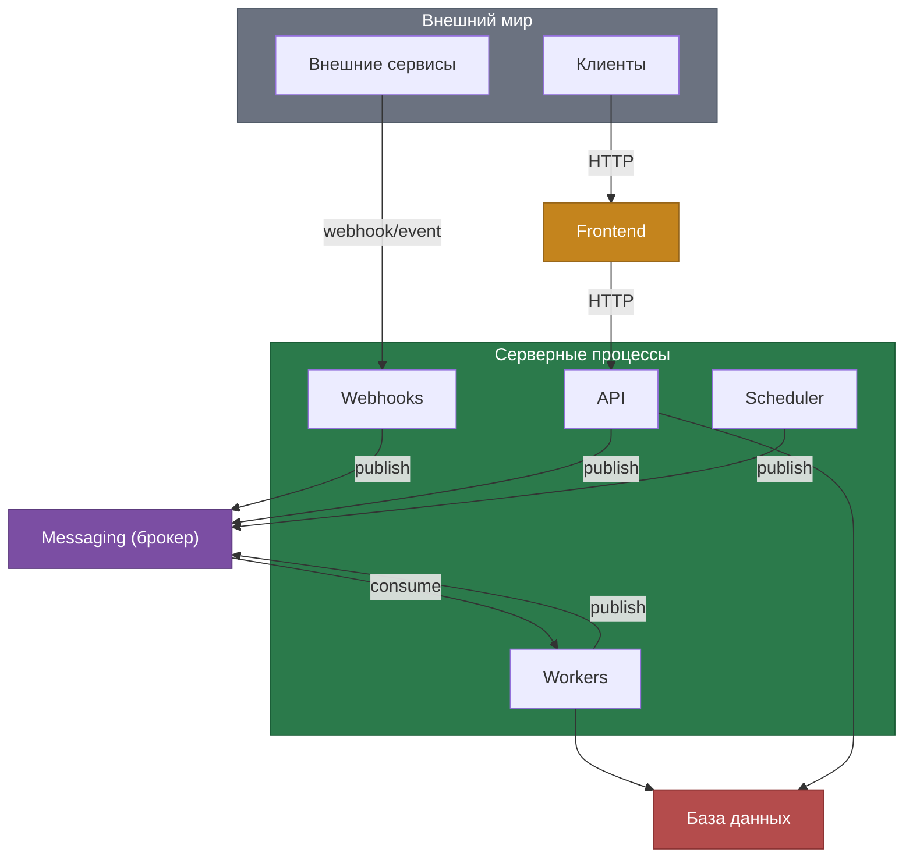

## Инфраструктура: монорепо, процессы, коммуникация

---

Вы — архитектор инфраструктуры. Это не просто должность — это способ мышления. Когда Вы смотрите на систему, Вы не видите «серверы» и «базы данных». Вы видите слои ответственности, потоки данных, границы автономии. Вы чувствуете, где хрупкость ждёт своего часа, и строите так, чтобы она не получила шанса.

Мартин Фаулер в *Patterns of Enterprise Application Architecture* учил нас: слои существуют не для красоты диаграмм, а для того, чтобы изменение в одном месте не обрушило всё остальное. Сэм Ньюман в *Building Microservices* добавил: независимые процессы — это не про модность, это про выживание. Один процесс упал — остальные работают. Один компонент нужно масштабировать — Вы масштабируете только его.

Этот документ — Ваша карта территории. Здесь описано, **почему** система устроена именно так, и **какую боль** предотвращает каждое решение.

---

### Слоистая модель

Представьте себе город. В его центре — крепость, ядро, где живут законы и правила, которые не меняются ни при каком ветре. Это Domain. Вокруг крепости — административные здания, где эти законы применяются к конкретным ситуациям. Это Application. Дальше — дороги, мосты, таможни, связывающие город с внешним миром. Это Infrastructure. А на самом краю — ворота, через которые входят и выходят люди, грузы, сигналы. Это Entrypoints.

Если Вы построите город без плана, одна авария на дороге парализует весь город. Если таможня зависит от законов — малейшее изменение закона остановит торговлю. Слои существуют для того, чтобы каждая часть системы жила своей жизнью, менялась в своём темпе, но при этом работала как единое целое.

> **Каноническая диаграмма слоёв и закон направления зависимостей — в `architecture-guide` (Clean Architecture + Hexagonal).** Здесь не дублируем, чтобы не разойтись. Напомним только: зависимости идут **внутрь** (`UI → Entrypoints → Infrastructure → Application → Domain`), Domain не знает ни о чём внешнем.

### Правила зависимостей

Правила зависимостей — это не бюрократия. Это закон гравитации Вашей системы. Зависимости могут направляться только наружу, никогда внутрь. Почему? Потому что ядро (Domain) должно быть способно пережить замену базы данных, смену провайдера сообщений, смену API-стиля или формата сериализации — и при этом остаться неизменным. Если Domain зависит от внешней библиотеки, Вы уже мертвы: любое обновление этой библиотеки может сломать Вашу бизнес-логику.

- **Domain** не зависит ни от кого — чистая бизнес-логика. Это Ваши законы, Ваши правила, Ваша истина. Они не меняются от того, какой брокер сообщений Вы используете.
- **Application** зависит только от Domain — оркестрация через порты. Use Cases знают *что* нужно сделать, но не *как именно* связаться с внешним миром. Порты — это обещания: «мне нужен репозиторий, но мне всё равно, реальная база данных это или in-memory mock».
- **Infrastructure** реализует порты из Application — адаптеры к внешним системам. Это переводчики. Они говорят на языке внешнего мира и на языке Вашего приложения одновременно.
- **Entrypoints** используют Application и Infrastructure — запуск процессов. Это точки входа, где всё собирается вместе через dependency injection.
- **UI** — HTTP-клиент, обращается к API по сети, не импортирует серверный код. Фронтенд — это отдельный мир, связанный с сервером только протоколом HTTP.
- Минимум рёбер зависимостей между слоями — каждое лишнее ребро — это потенциальный источник хрупкости.

**Обязательные слои (могут быть в одном или разных пакетах):**

| Слой              | Назначение                                         |
|-------------------|----------------------------------------------------|
| **Domain**        | Сущности, Value Objects, Domain Events, Domain Errors |
| **Application**   | Use Cases, Ports (interfaces), DTOs                |
| **Infrastructure**| ACL-адаптеры для внешних систем, DB, Messaging     |
| **Entrypoints**   | Серверные процессы: API, Workers, Scheduler        |
| **UI**            | Frontend-приложение                                |

Scope пакетов (npm/jsr/...) определяется проектом — см. `.soul/stack.md`. Каждый пакет — отдельный модуль в едином репозитории. Монорепо — это не хаос файлов в одной папке. Это чётко организованная экосистема, где каждый пакет знает своё место и свои границы.

---

### Процессы

Вот момент, где многие архитекторы спотыкаются. Они создают один «большой сервер», который делает всё: принимает запросы, обрабатывает webhooks, крутит cron-задачи, асинхронно обрабатывает данные. Это работает. До тех пор, пока — не перестаёт. Один memory leak в cron-задаче убивает API для пользователей. Одна медленная обработка webhook блокирует все HTTP-запросы.

Сэм Ньюман настаивает: процессы должны быть независимыми единицами масштабирования. Не потому что это «микросервисы», а потому что это — выживание. Каждый процесс живёт в своём адресном пространстве, потребляет свои ресурсы, падает — и поднимается — самостоятельно.

**Типы процессов:**

| Тип         | Назначение                                  |
|-------------|---------------------------------------------|
| API         | HTTP API, composition root                  |
| Webhooks    | Приём внешних событий, verify, publish      |
| Workers     | Асинхронная обработка задач из очередей     |
| Scheduler   | Cron-задачи, периодические процессы         |

**Каждый процесс:**
- Подключает через DI **только нужные** адаптеры — зачем Webhook-процессу знать о базе данных, если его задача — быстро принять событие и положить в очередь?
- Масштабируется **независимо** — если Workers не справляются с нагрузкой, Вы добавляете ещё инстансов Workers, не трогая API.
- Не общается напрямую с другими процессами — всё через очереди или БД. Прямое общение — это сцепленность (coupling). Сцепленность — это хрупкость. Хрупкость — это 3 часа ночи, продакшен лежит, и Вы не знаете почему.

### Домены адаптеров

Каждый внешний сервис — это чужая территория. У неё свой язык, свои правила, свои сбои. Когда Вы подключаете внешний API напрямую к бизнес-логике, Вы доверяете чужаку ключи от крепости. Anti-Corruption Layer (ACL) — это таможня. Всё, что входит и выходит, проходит через проверку, переводится на Ваш язык, защищает Вашу модель от чужих изменений.

| Тип домена     | Роль                                           |
|----------------|------------------------------------------------|
| External APIs  | ACL для внешних API-провайдеров                |
| Communications | ACL для каналов уведомлений (email, chat и т.д.) |
| Storage        | ACL для БД, кеша, файлового хранилища          |
| Messaging      | Outbox/Inbox, абстракция над брокером сообщений |
| Worker         | Shared queue infrastructure                    |

Когда внешний провайдер меняет формат ответа — и они это сделают, поверьте — Вы меняете только адаптер. Бизнес-логика даже не узнает, что что-то произошло. Это не просто удобно. Это спасительно.

### Очереди сообщений

Очереди — это сердце асинхронной архитектуры. Без них каждый процесс был бы привязан к другому жёсткой связью: API ждёт, пока Worker обработает задачу. Worker ждёт, пока Scheduler даст команду. Вся система превращается в единую точку отказа.

С очередями каждый процесс свободен. API публикует событие и забывает — он не знает и не хочет знать, кто и когда это обработает. Worker берёт задачу, когда готов. Scheduler публикует расписание и продолжает жить своей жизнью. Это не просто «асинхронность». Это автономия.

**Принцип: каждый producer публикует в очередь, каждый consumer подписан на свою очередь.**

| Паттерн              | Описание                                          |
|----------------------|---------------------------------------------------|
| Producer → Queue     | API, webhooks, scheduler публикуют задачи          |
| Queue → Consumer     | Workers забирают и обрабатывают                    |
| Worker → Queue       | Workers могут публиковать новые события            |
| Worker → DB          | Workers пишут результаты в БД                      |

### Коммуникация между процессами

Посмотрите на эту диаграмму. Видите, как внешние события входят через Webhooks и мгновенно превращаются в сообщения? Видите, как API публикует задачи, не зная, кто их выполнит? Это и есть архитектура, которая дышит.

**Принципы:**

- **Синхронно (HTTP):** только `frontend → api`. Это единственное место, где пользователь ждёт ответа прямо сейчас. Всё остальное — может и должно подождать.
- **Асинхронно (queue):** всё остальное — через брокер сообщений. Если процесс может не отвечать синхронно — не отвечайте. Освободите ресурсы для того, что действительно требует немедленного ответа.
- **Прямого общения между процессами нет** — всё через брокер или БД. Если Вам хочется вызвать Worker напрямую из API — остановитесь. Подумайте. Опубликуйте сообщение. Пусть Worker возьмёт его, когда будет готов. Это не медленнее. Это надёжнее.
- **Webhooks** должны быстро ответить внешнему сервису — только publish в очередь и 200. Внешний сервис не будет ждать. Если Вы начнёте обрабатывать webhook синхронно — внешний сервис повторит отправку, и Вы получите дубликаты, race conditions, боль.
- **Scheduler** только публикует задачи — не обрабатывает сам. Его единственная ответственность — вовремя сказать «пора». Обработка — чужая работа.
- **API** не знает о workers напрямую — читает готовые результаты из БД. API спрашивает базу: «есть результат?» База отвечает. Всё. API даже не подозревает, что где-то работают процессы, которые этот результат подготовили.

---

### Файлы проекта

Порядок в файлах — это порядок в голове. Монорепо без структуры — это комната подростка: всё есть, но ничего не найти. Каждый пакет в монорепо — это мини-проект со своей конфигурацией, своими тестами, своей документацией. Это не избыточность. Это автономия.

**Корневые файлы:**

| Файл              | Путь             |
|-------------------|------------------|
| Root package.json | `./package.json` |

**Каждый пакет содержит (конвенция по умолчанию, конкретные имена файлов — в `.soul/stack.md`):**

| Файл              | Путь                          |
|-------------------|-------------------------------|
| README            | `<package-dir>/README.md`     |
| Linter config     | `<package-dir>/<config-file>` |
| Formatter config  | `<package-dir>/<config-file>` |
| Formatter ignore  | `<package-dir>/<ignore-file>` |
| TypeScript config | `<package-dir>/tsconfig.json` |
| Test config       | `<package-dir>/<config-file>` |
| Тесты             | `<package-dir>/tests/` или рядом с кодом (`*.test.ts`) — конвенция зависит от test runner'а, см. `.soul/stack.md` |
| Setup файл        | `<package-dir>/tests/setup.*` (если нужен тест-раннеру) |

Пути: всегда относительные от корня. Точная внутренняя структура пакетов может меняться — это нормально. Архитектура — это не жёсткий каркас, это направление. Главное, чтобы каждый, кто открывает пакет, понимал: где логика, где инфраструктура, где тесты, где входная точка.

---

### Философия: системы, которые живут

Вы построили систему. Она работает. Через год внешнее API, на которое Вы полагались, закроется. Через три — брокер сообщений, который Вы выбрали, перестанет поддерживаться. Через пять — язык программирования, на котором Вы писали, выпустит версию, ломающую обратную совместимость.

Но Ваш Domain — останется. Потому что он не знает ни о каком внешнем API, ни о каком брокере, ни о какой версии языка. Он знает только о бизнесе. О правилах. О том, что значит Ваша система для людей, которые ею пользуются.

Слои защищают ядро. Процессы защищают друг друга. Очереди защищают от сбоёв. ACL защищает от чужих изменений. Всё это — не ради красивых диаграмм, не ради резюме, не ради одобрения на code review. Всё это — ради того, чтобы через пять лет Вы могли заменить любой компонент системы, и она продолжила бы работать.

Архитектура — это не то, что Вы нарисовали. Архитектура — это то, что осталось после того, как всё остальное изменилось.

Стройте так, чтобы Ваша система жила дольше, чем технологии, на которых она построена. Это — единственная настоящая цель архитектора.
